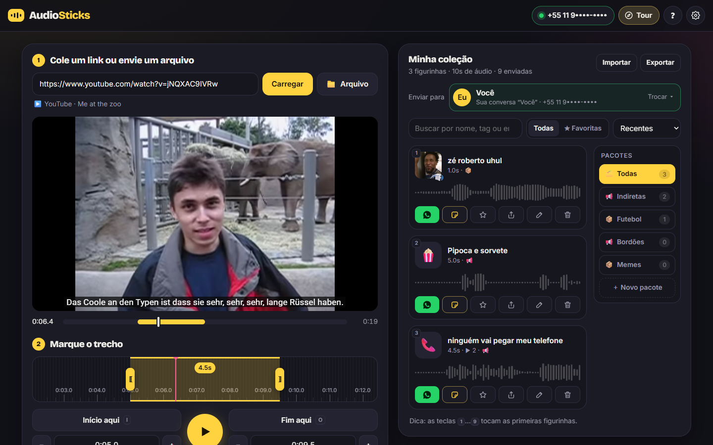
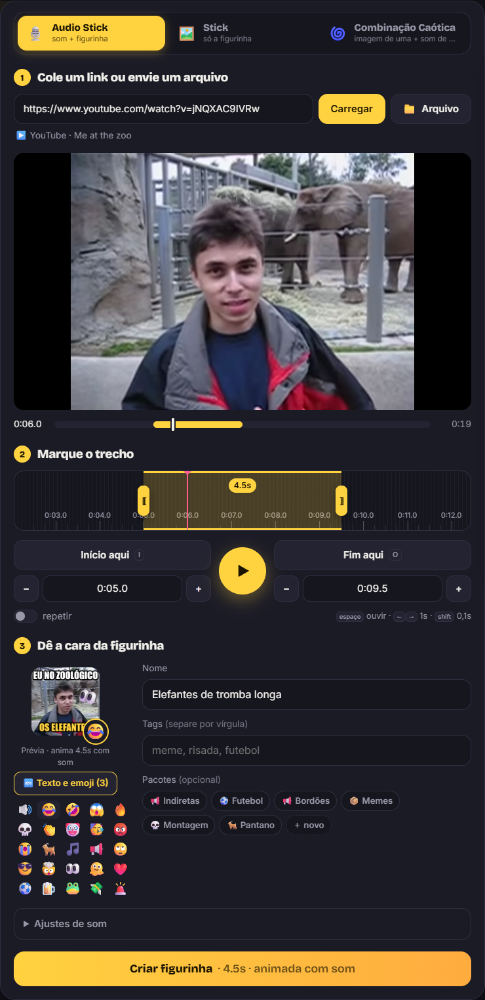
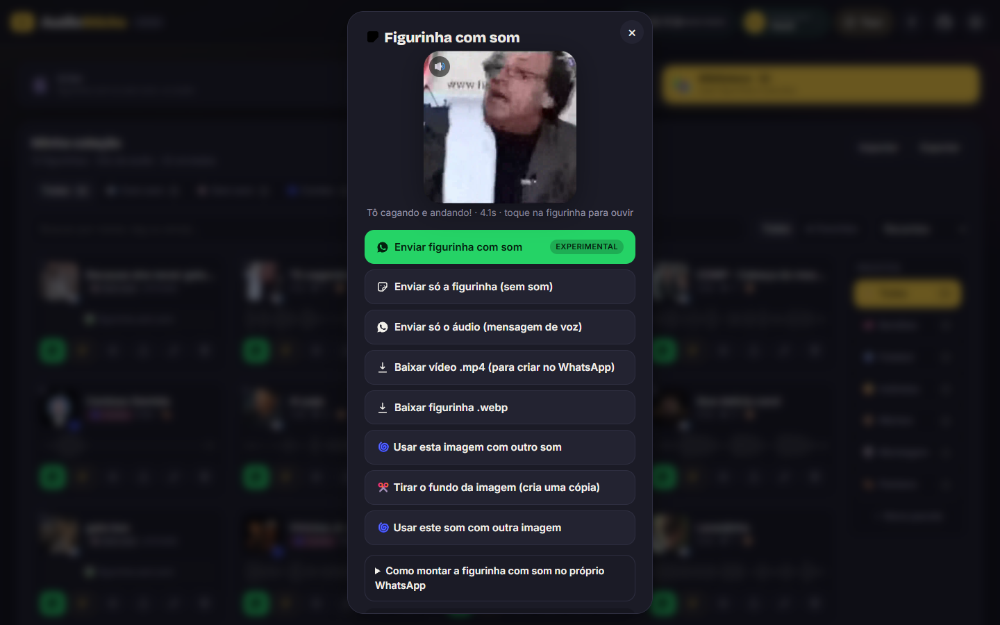
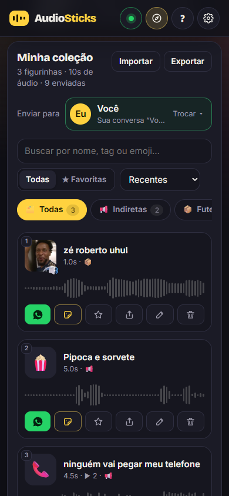
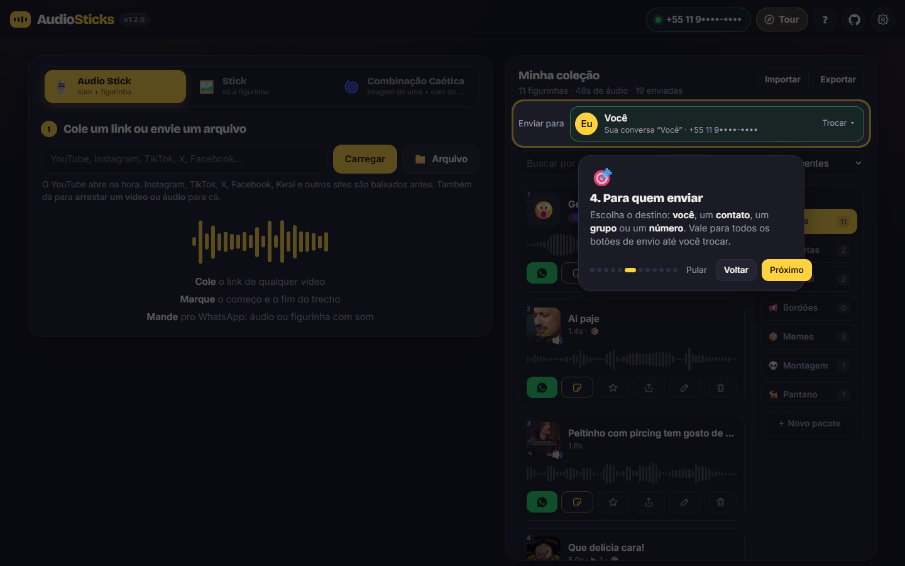
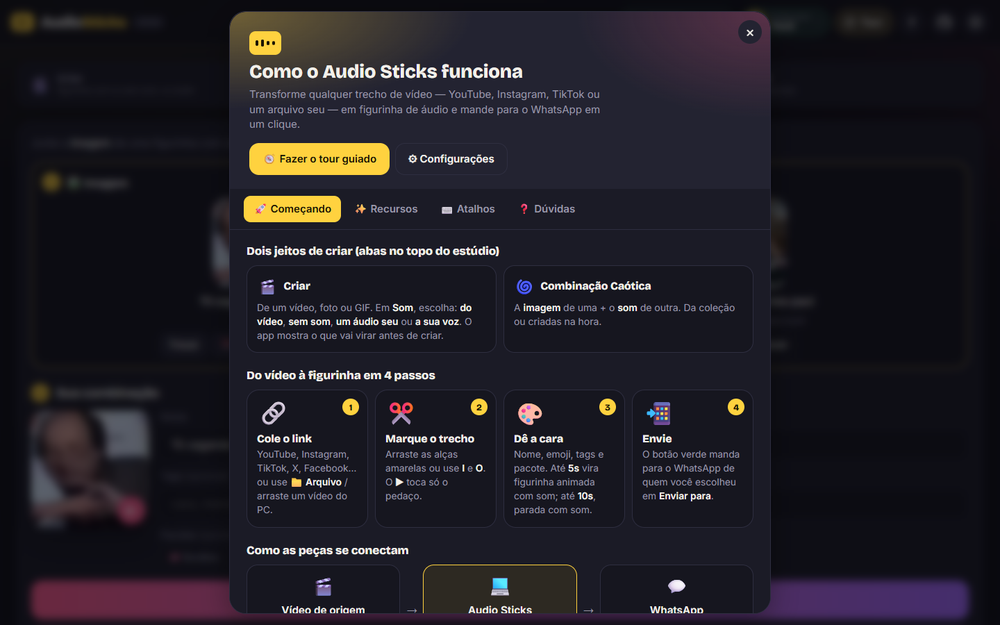
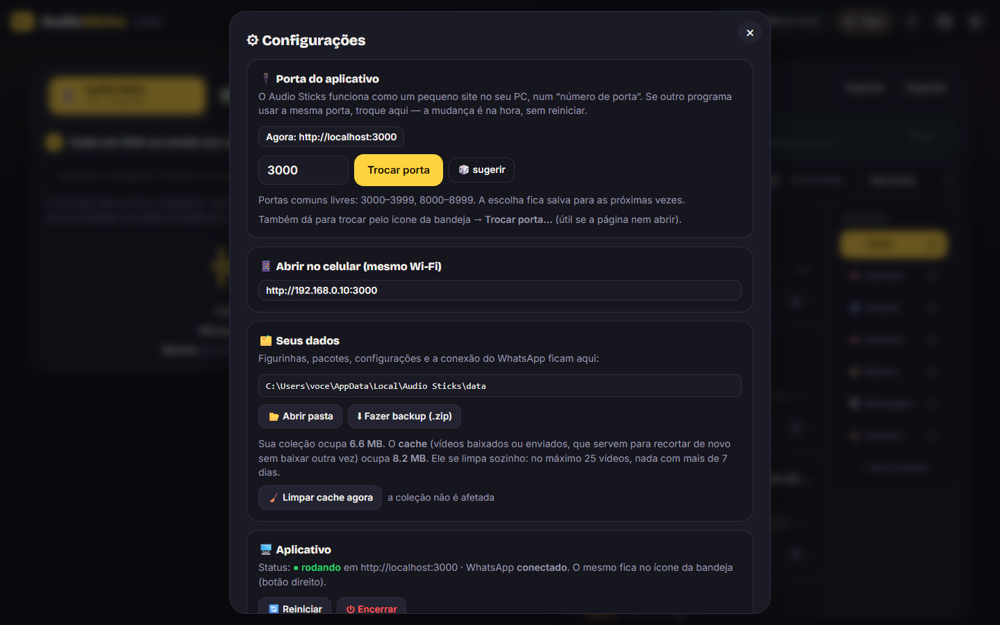
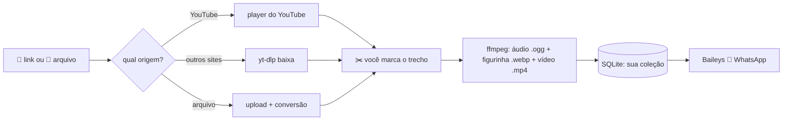

<div align="center">


# 🔊 ZapSticks do Caos

### *Audio Sticks: porque mandar "kkkkkk" já não basta.*

Transforma **qualquer trecho de vídeo** (YouTube, Instagram, TikTok, X, Facebook ou um arquivo seu) em **figurinha de áudio** e manda direto no **WhatsApp**.
Para você, para um contato, para o grupo da família às 6h da manhã. A responsabilidade é sua. 🫡


<br>

[](https://github.com/ivandneto/zapsticks-do-caos/releases/latest)

<sub>Sem instalar nada: baixa, extrai, dá dois cliques. O <a href="https://github.com/ivandneto/zapsticks-do-caos/releases/latest">passo a passo para leigos</a> está na página de download.</sub>

</div>

---

## 🤔 O que é isso?

Sabe aquele momento do vídeo que **resume perfeitamente** o que você quer dizer no grupo?
Pois é. Agora ele vira figurinha. Com som. Em três cliques.

```
 🎬 vídeo  ──►  ✂️ recorta  ──►  🎨 vira figurinha  ──►  💬 WhatsApp  ──►  😂 caos instaurado
```

## 📸 A cara do bicho

<p align="center">
  
</p>

<table>
  <tr>
    <td width="50%" align="center"><br><sub><b>Estúdio</b>: marca o trecho, vê a prévia e cria</sub></td>
    <td width="50%" align="center"><br><sub><b>Figurinha com som</b>: com som, sem som, só áudio ou .mp4</sub><br><br><br><sub><b>No celular</b>: funciona no mesmo Wi-Fi</sub></td>
  </tr>
  <tr>
    <td align="center"><br><sub><b>Tour guiado</b>: para quem não lê README 👀</sub></td>
    <td align="center"><br><sub><b>Ajuda</b>: passo a passo, recursos, atalhos e dúvidas</sub></td>
  </tr>
  <tr>
    <td colspan="2" align="center"><br><sub><b>Configurações</b>: troca de porta na hora, endereço para o celular, backup, reiniciar e encerrar</sub></td>
  </tr>
</table>

## ✨ Funcionalidades (com seriedade questionável)

| | O quê | Detalhe |
|---|---|---|
| 🔗 | **Cola o link e pronto** | YouTube abre na hora. Instagram, TikTok, X, Facebook, Kwai e centenas de outros: o app baixa sozinho. |
| 📁 | **Arquivo do PC** | Arrasta o vídeo, áudio, **foto ou GIF** (inclusive o `.webp` animado do Giphy) para a tela. Até aquele `.mov` de 2014. Ou cola o link direto do Giphy/Tenor. |
| 🖼️ | **Stick** | Só a figurinha, sem som: de foto, GIF ou trecho de vídeo. Recortada em quadrado ou inteira com fundo transparente. |
| 🌀 | **Combinação Caótica** | A cara de uma figurinha com a voz de outra. O gato com a risada do Faustão? Pode. Da coleção ou criado na hora, e as peças temporárias se apagam sozinhas. |
| ✂️ | **Corte cirúrgico** | Régua com zoom, alças arrastáveis, ajuste de 0,1s. Precisão de neurocirurgião, propósito de meme. |
| 🎞️ | **Figurinha com som** | Até 5s: animada com som. De 5 a 10s: parada com som (são as regras do WhatsApp, não nossas). *(experimental: o WhatsApp lançou isso ontem, literalmente)* |
| ✂️ | **Tirar o fundo** | Igual ao WhatsApp: IA recorta a pessoa sozinha (até em **vídeo e GIF**, quadro a quadro), ou você toca no que quer manter. Pincel, sensibilidade e borda branca. Roda no seu navegador, nada vai para a nuvem. |
| 🔤 | **Texto e emoji** | Escreve na figurinha com fonte de meme (Impact, Bangers, Comic Sans 🤡…), cor, borda, tamanho e inclinação, e cola emoji por cima. Tem botão "Meme clássico". Em foto, GIF e vídeo. |
| 🎙️ | **Áudio com ondinha** | Chega como se você mesmo tivesse gravado. Ninguém precisa saber. |
| 📦 | **Pacotes** | Organize por categoria: 😂 Memes, ⚽ Futebol, 🙄 Indiretas pro grupo. Manda o pacote inteiro de uma vez. |
| 🎯 | **Enviar para** | Você, um contato, um grupo ou um número digitado. Mira e dispara. |
| 🎛️ | **Mesa de som** | Teclas `1` a `9` tocam as figurinhas. Ideal para reuniões on-line (não recomendamos). |
| 🧭 | **Tour guiado** | Para quem não lê README. Tipo você, que pulou direto para esta tabela. |
| 🖥️ | **Mora na bandeja** | No Windows vira um iconezinho perto do relógio, com bolinha de status: 🟢 conectado, 🟠 pensando, ⚪ dormindo. |
| 💸 | **Grátis** | Sem assinatura, sem nuvem, sem "plano premium". Roda no seu PC. |

## 🚀 Como usar

### Jeito preguiçoso (Windows)

1. Baixe o `.zip` em **[Releases](https://github.com/ivandneto/zapsticks-do-caos/releases/latest)**. Tem um lá agora, juro. Até guia para leigos tem. 👀 (Ou gere você mesmo com `npm run build:exe`, se gosta de sofrer.)
2. Descompacte e dê dois cliques no **`Audio Sticks.exe`**.
3. Se o Windows reclamar ("O Windows protegeu o computador"): **Mais informações → Executar assim mesmo**. Ele só está com ciúmes porque o app não tem assinatura digital paga.

> Na primeira vez ele baixa uns 200 MB de ferramentas (yt-dlp, ffmpeg…). Vai buscar um café. ☕
>
> E relaxa: o cache de vídeos se limpa sozinho. O app não vira um lixão no seu HD. 🧹

### Jeito dev

```bash
git clone https://github.com/ivandneto/zapsticks-do-caos.git
cd zapsticks-do-caos
npm install
npm start          # http://localhost:3000
```

Precisa de **Node 22.5+**. O resto o app baixa sozinho.

### Conectando o WhatsApp

Clique no status lá em cima → **Gerar QR code** → no celular: *Aparelhos conectados → Conectar aparelho*. Igualzinho ao WhatsApp Web.

## 🧠 Como funciona por dentro



- **Servidor:** Node + Express, SQLite embutido no Node (`node:sqlite`), zero banco para instalar.
- **Página:** HTML, CSS e JS puros. Sem framework e sem build.
- **WhatsApp:** [Baileys](https://github.com/WhiskeySockets/Baileys), conexão como um WhatsApp Web.
- **Mídia:** [yt-dlp](https://github.com/yt-dlp/yt-dlp) + [ffmpeg](https://ffmpeg.org/), os verdadeiros heróis desta história.
- **Executável:** Node SEA (Single Executable Application) + esbuild, com ícone de bandeja feito em PowerShell. Sim, PowerShell. Funciona. Não pergunte.

📖 Manual completo: **[LEIAME.md](LEIAME.md)** · 🔧 Documentação técnica: **[docs/DESENVOLVIMENTO.md](docs/DESENVOLVIMENTO.md)**

## ❓ FAQ que ninguém pediu

<details>
<summary><b>É de graça mesmo?</b></summary>

É. O único custo é social: seus amigos vão te silenciar no grupo.
</details>

<details>
<summary><b>A figurinha com som chegou como "mensagem não suportada". Por quê?</b></summary>

Porque o WhatsApp lançou esse formato em 24/11/2026 e a gente montou a mensagem na unha, byte por byte, com base em engenharia reversa. Às vezes o zap entende, às vezes não. Se não entender, manda como áudio ou baixa o `.mp4` e cria a figurinha no próprio WhatsApp. É ciência. 🧪
</details>

<details>
<summary><b>No WhatsApp Web a imagem e o som da figurinha saem fora de sincronia!</b></summary>

Culpa do WhatsApp Web, juro. Lá a animação fica rodando em loop sozinha e o som entra em qualquer ponto dela. No celular fica certinho. A gente mediu: som e imagem saem do mesmo milésimo de segundo. 🔬
</details>

<details>
<summary><b>O recorte de fundo é bom mesmo?</b></summary>

Para pessoas, é bem bom. Para cabelo arrepiado, é "bem bom" com aspas. Tem pincel para os retoques. E sim, ele recorta o seu amigo **dançando no vídeo**, quadro a quadro. Use com responsabilidade. 💃
</details>

<details>
<summary><b>Meu número pode ser banido?</b></summary>

A conexão não é oficial. Mandar para você mesmo é tranquilo. Disparar 400 figurinhas para 80 grupos em 3 minutos **não é**. O app até espaça os envios de pacotes, mas bom senso não vem no `npm install`.
</details>

<details>
<summary><b>Funciona no Mac / Linux?</b></summary>

O app sim (`npm start`). O executável e o ícone de bandeja são exclusivos do Windows, por enquanto.
</details>

<details>
<summary><b>Por que "ZapSticks do Caos"?</b></summary>

Porque "Ferramenta de Extração e Segmentação de Mídia Audiovisual para Mensageria Instantânea" não cabia no logo.
</details>

## ⚠️ Avisos (agora sério, de verdade)

- Baixar conteúdo do YouTube, Instagram, TikTok etc. pode ir contra os termos desses serviços. **Use para fins pessoais** e respeite quem criou o conteúdo.
- A conexão com o WhatsApp usa uma biblioteca **não oficial**. Use com moderação.
- A pasta `data/whatsapp-auth` é **a chave do seu WhatsApp**. Nunca envie, nunca suba para o GitHub (o `.gitignore` já protege).
- Projeto feito por diversão. Sem garantias, sem SLA, sem suporte 24h. Com muito amor, isso sim.

## 🤝 Contribuindo

Achou um bug? Tem uma ideia absurda? Abre uma issue. PRs são bem-vindos, principalmente os que vêm com meme na descrição.

## 🎬 Créditos

| | Quem | Fez o quê |
|---|---|---|
| 🧑‍💻 | **[Ivan](https://github.com/ivandneto)** | A ideia, o caos, os testes no grupo e a cara de pau de pedir "faz bem bonito" |
| 🤖 | **Claude** (Anthropic) | Co-autor do código, via Claude Code. Escreveu muito `ffmpeg -i` e descobriu do jeito difícil que o `[Console]::In` do PowerShell trava a bandeja |

Agradecimentos aos verdadeiros pilares: **yt-dlp**, **ffmpeg** e **Baileys**. Sem eles, isto aqui seria só um botão amarelo.

## 📜 Licença

[MIT](LICENSE). Faça o que quiser, só não diga que fui eu que mandei aquele áudio no grupo.

<div align="center">

---

Feito com 🔊, ☕ e uma quantidade preocupante de `ffmpeg -i` · 🇧🇷

</div>
